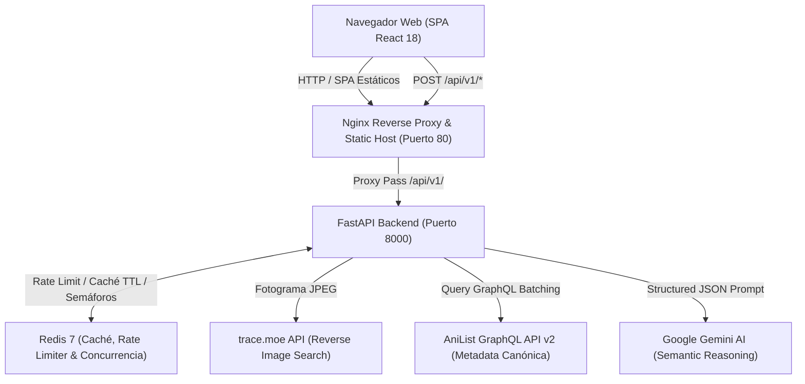
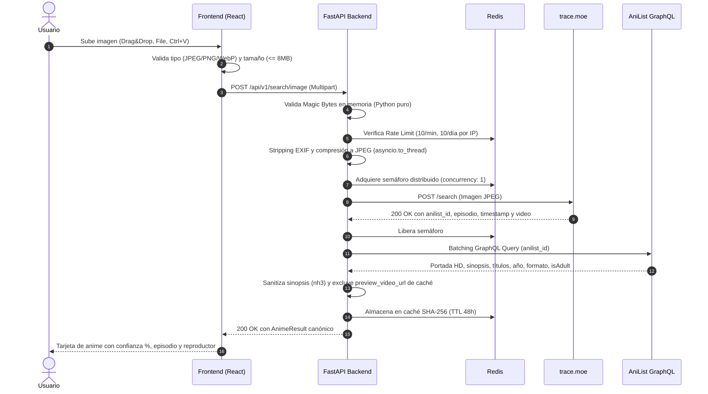
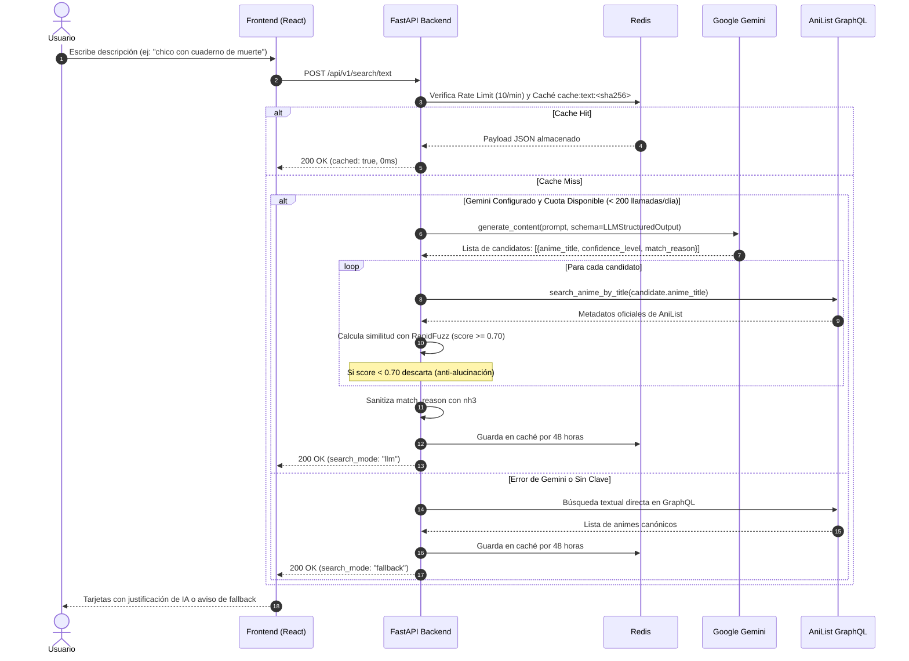

# Arquitectura del Sistema - AnimeFinder

Este documento describe la arquitectura técnica, los flujos de datos y los patrones de resiliencia implementados en **AnimeFinder**.

---

## 1. Topología del Sistema

---

## 2. Flujos de Secuencia de Búsqueda

### 2.1 Búsqueda Inversa por Imagen (`POST /api/v1/search/image`)

### 2.2 Búsqueda Textual Libre con Fallback (`POST /api/v1/search/text`)

---

## 3. Principios de Resiliencia y Mitigación de Cuotas

1. **Gestión de Cuota de trace.moe:**
   - La API gratuita de trace.moe asigna 100 consultas por cada 24 horas móviles por IP y concurrencia máxima 1.
   - El backend sincroniza `quota` y `quotaUsed` dinámicamente desde `/me` al inicio y tras errores 402.
   - El semáforo en Redis coordina las solicitudes para evitar saturación y colas 503.
2. **Degradación de AniList GraphQL:**
   - AniList se encuentra en modo degradado documentado a 30 req/min.
   - AnimeFinder implementa batching automático en 1 única petición con alias para múltiples IDs de anime.
   - Respeta estrictamente la cabecera `Retry-After` ante códigos 429.
   - Metadatos estables se almacenan en caché de Redis durante 48 horas.
3. **Protección de Presupuesto en LLM:**
   - `LLM_DAILY_CALL_CAP = 200` garantiza un límite rígido diario en Redis.
   - En caso de superarse el tope o no contar con `GEMINI_API_KEY`, el sistema conmuta automáticamente a búsqueda directa en AniList sin interrumpir el servicio al usuario.
