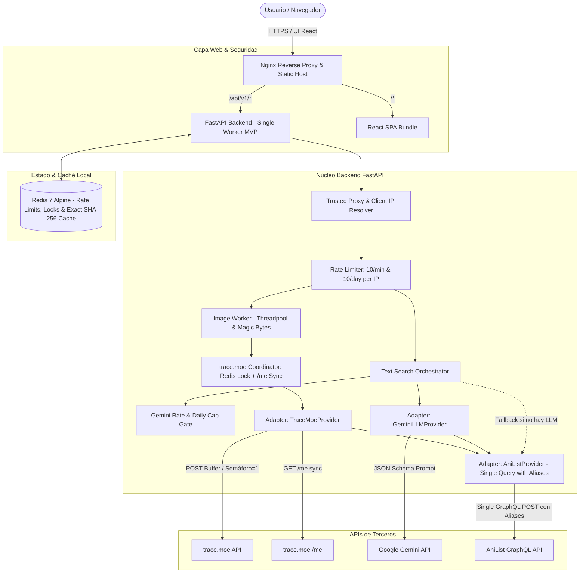

# Documento de Planificación y Arquitectura Técnica (Fase 0 — Revisión v1.2)
**Proyecto:** AnimeFinder  
**Rol:** Senior Software Engineer / Tech Lead  
**Estado:** Arquitectura Técnica Aprobada por el Product Owner — Lista para Implementación  
**Fecha:** Octubre 2026  

---

## 0. Cambios Respecto a Versiones Anteriores (Changelog v1.0 -> v1.1 -> v1.2)

### Novedades v1.2:
1. **Concurrencia trace.moe y Circuit Breaker centralizado en Redis:** El semáforo de concurrencia (`TRACEMOE_MAX_CONCURRENCY=1`) y el estado del circuit breaker se almacenan y coordinan en Redis para admitir múltiples workers o escalado horizontal sin colisiones. Para el MVP se documenta la ejecución con un único worker principal de FastAPI.
2. **Diferenciación de significado del HTTP 402 en trace.moe:** trace.moe devuelve 402 tanto para cuota diaria agotada como para concurrencia excedida (`error: "Concurrency limit exceeded"` vs `"Search quota depleted"`). Ante un 402, el backend parsea el cuerpo de error y consulta `/me` antes de marcar el presupuesto global como agotado.
3. **Sincronización dinámica de cuota con `/me`:** Al arrancar el backend y tras recibir un 402, el sistema consulta `https://api.trace.moe/me`, lee `quota` y `quotaUsed`, y deriva el tope real restante (`remaining = quota - quotaUsed`) en lugar de fijar un número estático como 95.
4. **Límite diario por IP en búsqueda de imágenes:** Se añade `IMAGE_SEARCH_PER_IP_PER_DAY=10` en Redis (con ventana de 24 horas), impidiendo que un solo usuario monopolice la cuota global del servidor, complementando el límite de 10 req/min.
5. **Exclusión de `preview_video_url` del Caché de Imágenes:** Las URLs de preview de trace.moe (`/video/{id}`) caducan a los 300 segundos (5 minutos). Por tanto, la respuesta cacheada en Redis excluye este link temporal o se almacena un flag para regenerarlo/omitirlo si la consulta proviene de caché.
6. **Ampliación del Contrato de API:** Se incorporan en las respuestas de búsqueda los campos `search_mode: "llm" | "fallback"` (para visibilidad en UI de qué motor resolvió la consulta) y `filtered_count: int` (número de resultados descartados por filtro de contenido adulto o umbral mínimo de título).
7. **Actualización de "Datos no verificados":** Se trasladan a la sección de datos no verificados: el modelo vigente por defecto `GEMINI_MODEL`, los límites exactos de cuota RPM/RPD de Google Gemini en su tier gratuito, y la dinámica exacta de rolling window de trace.moe.
8. **Ratificación de Alcance Completo no Negociable:** Se ratifica expresamente en el plan que Dockerfiles multi-stage con usuario no-root, healthchecks en compose, headers de seguridad HTTP, auditoría de dependencias (`pip-audit`, `npm audit`), política de logs estructurados sin PII, `README.md`, `SECURITY.md` y Architecture Decision Records (ADRs) forman parte integral del alcance obligatorio.

---

## 1. Datos Verificados vs. Datos No Verificados

### 1.1 Datos Verificados Oficialmente
* **trace.moe:**
  - Endpoint de introspección `/me`: verificado en vivo con respuesta real `{"id":"...","priority":0,"concurrency":1,"quota":100,"quotaUsed":0}`.
  - Concurrencia máxima gratuita = 1; prioridad = 0 (la más baja en cola).
  - Códigos HTTP oficiales: 400 (imagen malformada), 402 (cuota agotada O concurrencia excedida), 403 (clave inválida), 429 (límite HTTP > 100 req/min), 503 (cola de prioridad llena), 504 (servidor sobrecargado).
  - Vencimiento de URLs de preview: las URLs temporales de `/video/{id}` e `/image/{id}` expiran formalmente a los 300 segundos.
* **AniList API (GraphQL v2):**
  - Rate limit documentado en estado degradado oficial a 30 req/min (frente a 90 baseline), con limitador de ráfagas.
  - Cabeceras de control: `X-RateLimit-Limit`, `X-RateLimit-Remaining`, `Retry-After` (segundos ante 429) y `X-RateLimit-Reset` (timestamp Unix).
  - Términos de uso: prohíbe uso comercial no autorizado, almacenamiento masivo permanente (hoarding) y scraping masivo.

### 1.2 Datos No Verificados (Marcados Explícitamente)
* **Default y límites exactos de Gemini:** La disponibilidad exacta de nombres de modelo en Google AI Studio (`gemini-1.5-flash`, `gemini-2.0-flash`, `gemini-2.5-flash`) y sus cuotas exactas RPM/RPD varían dinámicamente según la región y tipo de cuenta de Google. Se marcan como no verificados y deben configurarse vía variable de entorno `GEMINI_MODEL` con fallback a AniList garantizado.
* **Fórmula interna del Burst Limiter de AniList:** La documentación no divulga los parámetros matemáticos ni la ventana de milisegundos exacta; se implementa espaciador conservador.
* **Dinámica exacta de reset de la ventana móvil de trace.moe:** La documentación indica una ventana móvil de 24 horas, pero el cálculo interno exacto (rolling log vs tumbling window) se verifica mediante llamadas periódicas de sincronización a `/me`.

---

## 2. Investigación y Matriz de Fuentes de Datos

| Fuente / API | Qué Resuelve | Límites y Cuotas Reales | Costos | Términos de Uso (ToS) | Calidad y Formato | Mitigaciones en Arquitectura |
| :--- | :--- | :--- | :--- | :--- | :--- | :--- |
| **trace.moe** | Búsqueda inversa de fotogramas de anime (MPEG-7 Color Layout + Milvus). | - **Free / Anónimo:** 100 req / 24h móviles por IP de salida.<br>- **Concurrencia:** 1 petición simultánea.<br>- **HTTP Rate Limit:** 100 req/min. | Gratuito para tier básico; donaciones para cuota extendida. | Atribución obligatoria ("Powered by trace.moe"). Prohibido uso comercial o scraping masivo. Previews caducan en 5 min. | Altísima (~98%) para fotogramas reales de TV/películas. Entrega `anilist_id`, episodio y timestamp exacto. | Semáforo distribuido en Redis (`TRACEMOE_MAX_CONCURRENCY=1`), sincronización con `/me`, deduplicación por `anilist_id` y límite diario de 10 por IP de usuario. |
| **AniList API (GraphQL v2)** | Catálogo canónico de metadatos de anime, sinopsis, año, formato, portadas HD, títulos multi-idioma y tags. | - **Estado Actual Degradado:** 30 req/min.<br>- **Burst Limiter:** Activo.<br>- Header `Retry-After` ante 429. | 100% Gratuito. | Uso no comercial; prohibido almacenar permanentemente o realizar hoarding de datos. | Extraordinaria. Respuestas estructuradas GraphQL. Contiene títulos (romaji, english, native) y flag `isAdult`. | **Batching en 1 sola consulta GraphQL con aliases** para múltiples candidatos; caché en Redis (TTL 48h) y respeto estricto de `Retry-After`. |
| **Google Gemini API** | Razonamiento semántico sobre lenguaje natural libre (tropos, trama) y extracción estructurada de títulos. | - Tier Gratuito (AI Studio): sin tarjeta de crédito obligatoria.<br>- Cuota protegida por `LLM_DAILY_CALL_CAP`. | Gratuito en tier básico. | En tier gratuito de AI Studio, Google puede usar datos de entrada/salida para mejorar sus modelos. Prohibido contenido dañino. | Muy alta interpretación de descripciones vagas ("anime del chico del tractor"). | Validación estricta con `TITLE_MATCH_MIN_SCORE=0.70`, fallback automático a AniList, y límite cualitativo de confianza. |

---

## 3. Estrategia de Búsqueda por Descripción Libre

### 3.1 Pipeline de Resolución Inteligente
1. **Normalización del Input:** Se limpia el texto recibido (recorte a máx 500 caracteres, strip de caracteres de control).
2. **Caché Semántica Exacta:** Se consulta en Redis `cache:text:<sha256(texto_normalizado)>`. Si existe, se retorna inmediatamente con `cached: true`.
3. **Inferencia con LLM (Gemini):**  
   - Modelo: Configurable vía `GEMINI_MODEL` (default: `gemini-1.5-flash`).
   - Prompt con salida estructurada (JSON Schema) que solicita hasta 5 candidatos con:
     - `anime_title`: Título en romaji o inglés más representativo.
     - `confidence_level`: Nivel cualitativo (`"high"`, `"medium"`, `"low"`).
     - `match_reason`: Breve explicación de por qué coincide con la descripción.
4. **Validación y Enriquecimiento en Batch (AniList GraphQL):**  
   - Se genera **una única consulta GraphQL compuesta mediante aliases**:
     ```graphql
     query ResolveAnimeBatch {
       c0: Media(search: "Tondemo Skill de Isekai", type: ANIME) { ...AnimeFields }
       c1: Media(search: "Isekai Izakaya Nobu", type: ANIME) { ...AnimeFields }
     }
     ```
5. **Filtrado Anti-Alucinación (Fuzzy Match):**  
   - Se calcula similitud de texto (Token Sort Ratio) entre el `anime_title` propuesto por el LLM y los títulos de AniList (`romaji`, `english`, `synonyms`).
   - Si la coincidencia es inferior a `TITLE_MATCH_MIN_SCORE` (default `0.70`), **el candidato se descarta** y se incrementa `filtered_count`.
6. **Degradación Elegante / Fallback:**  
   - Si no se configuró `GEMINI_API_KEY`, si se superó `LLM_DAILY_CALL_CAP`, o si Gemini devuelve 429/500, el servicio degrada en forma automática a una búsqueda textual directa en AniList GraphQL (`search_mode: "fallback"`).

---

## 4. Arquitectura y Componentes del Sistema

### 4.1 Diagrama de Componentes



### 4.2 Coordinación de Concurrencia y Sincronización con `/me`
1. **Semáforo y Lock Distribuido en Redis:**  
   Se utiliza una clave en Redis `lock:tracemoe:concurrency` (o semáforo local asíncrono con único worker para el MVP) para asegurar que nunca se emitan 2 peticiones simultáneas hacia trace.moe.
2. **Diferenciación del Error HTTP 402:**  
   trace.moe devuelve 402 en dos casos:
   - Caso A: `{"error": "Concurrency limit exceeded"}`. En este caso el backend reintenta tras un breve backoff (250-500ms) sin marcar la cuota como agotada.
   - Caso B: `{"error": "Search quota depleted"}`. En este caso el backend confirma con `/me` y marca el flag en Redis `quota:tracemoe:depleted=true` con expiración calculada.
3. **Sincronización Dinámica de Cuota al Arrancar:**  
   Al inicializar la aplicación (`lifespan` de FastAPI), se ejecuta una llamada a `https://api.trace.moe/me`. Si `quotaUsed >= quota`, se activa el modo de cuota agotada de inmediato. Si no, se registra el saldo disponible en Redis.
4. **Protección Anti-Monopolio por Usuario:**  
   Cada IP de cliente tiene asignado un límite de `IMAGE_SEARCH_PER_IP_PER_DAY=10` en Redis. Esto garantiza que un único cliente no consuma el 100% de la cuota pública del servidor.

### 4.3 Manejo de Previews de Video No Cacheables
Las URLs devueltas por trace.moe en `result.video` caducan a los 300 segundos.  
- Al cachear el resultado en Redis por SHA-256 de la imagen, **el campo `preview_video_url` se almacena como `null` o se descarta de la caché**.  
- Si una búsqueda es servida desde caché (`cached: true`), el backend retorna los datos del anime pero omite `preview_video_url` o añade una indicación de preview expirada, previniendo links rotos en el frontend.

### 4.4 Seguridad y Calidad No Negociable
* **Dockerfiles Multi-Stage No-Root:** Contenedores basados en imágenes distroless o alpine, corriendo con usuario sin privilegios (`appuser`, UID 10001).
* **Healthchecks:** Configurados tanto en Dockerfile (`HEALTHCHECK`) como en `docker-compose.yml` para FastAPI, Nginx y Redis.
* **Headers de Seguridad:** Nginx y FastAPI inyectarán:
  - `Content-Security-Policy: default-src 'self'; img-src 'self' data: https://s4.anilist.co https://api.trace.moe; media-src 'self' https://api.trace.moe;`
  - `X-Content-Type-Options: nosniff`
  - `X-Frame-Options: DENY`
  - `Referrer-Policy: strict-origin-when-cross-origin`
* **Auditoría de Dependencias:** Bloqueo de PRs si `pip-audit` o `npm audit` detectan vulnerabilidades conocidas altas o críticas.
* **Logging Estructurado sin PII:** Logs en formato JSON que nunca registran imágenes binarias, direcciones IP completas sin anonimizar, ni textos sensibles.
* **Documentación y ADRs:** `docs/ARCHITECTURE.md`, `docs/SECURITY.md` y carpeta `docs/adr/` con decisiones registradas.

---

## 5. Contrato de API (OpenAPI 3.1)

### 5.1 Endpoints Principales

#### 1. `POST /api/v1/search/image`
* **Content-Type:** `multipart/form-data`
* **Parámetros:** `file` (UploadFile obligatorio, máx 8 MB).
* **Respuesta 200 OK:**
  ```json
  {
    "query_type": "image",
    "search_mode": "trace.moe",
    "cached": false,
    "filtered_count": 0,
    "processing_time_ms": 680,
    "results": [
      {
        "id": 16498,
        "title": {
          "romaji": "Shingeki no Kyojin",
          "english": "Attack on Titan",
          "native": "進撃の巨人"
        },
        "cover_image": "https://s4.anilist.co/file/anilistcdn/media/anime/cover/large/bx16498.jpg",
        "synopsis": "Centuries ago, mankind was slaughtered to near extinction...",
        "year": 2013,
        "format": "TV",
        "is_adult": false,
        "confidence_percentage": 98.2,
        "confidence_level": "high",
        "scene_info": {
          "episode": 1,
          "timestamp_seconds": 845.5,
          "timestamp_formatted": "14:05",
          "preview_video_url": "https://api.trace.moe/video/16498/..."
        }
      }
    ]
  }
  ```

#### 2. `POST /api/v1/search/text`
* **Content-Type:** `application/json`
* **Cuerpo:**
  ```json
  {
    "description": "Un chico que se transporta a otro mundo y cocina comida deliciosa para un lobo mítico",
    "limit": 5
  }
  ```
* **Respuesta 200 OK:**
  ```json
  {
    "query_type": "text",
    "search_mode": "llm",
    "cached": false,
    "filtered_count": 1,
    "processing_time_ms": 1120,
    "results": [
      {
        "id": 156094,
        "title": {
          "romaji": "Tondemo Skill de Isekai Hourou Meshi",
          "english": "Campfire Cooking in Another World with My Absurd Skill",
          "native": "とんでもスキルで異世界放浪メシ"
        },
        "cover_image": "https://s4.anilist.co/file/anilistcdn/media/anime/cover/large/bx156094.jpg",
        "synopsis": "Mukouda Tsuyoshi was summoned from modern Japan to a different world...",
        "year": 2023,
        "format": "TV",
        "is_adult": false,
        "confidence_percentage": null,
        "confidence_level": "high",
        "match_reason": "El protagonista invocado a otro mundo desarrolla habilidades culinarias y forma un pacto con el lobo legendario Fenrir.",
        "scene_info": null
      }
    ]
  }
  ```

#### 3. `GET /api/v1/health`
* **Respuesta 200 OK:**
  ```json
  {
    "status": "healthy",
    "timestamp": "2026-10-15T19:40:00Z",
    "services": {
      "redis": "connected",
      "tracemoe_budget_remaining": 85,
      "anilist_state": "degraded_30rpm",
      "search_mode_default": "llm"
    }
  }
  ```

---

## 6. Variables de Entorno y Configuración Tipada (`.env.example`)

```env
# --- Configuración del Servidor ---
ENVIRONMENT=development
PORT=8000
DEBUG=false
TRUSTED_PROXIES="127.0.0.1,172.16.0.0/12,10.0.0.0/8"
CORS_ORIGINS="http://localhost:5173,http://localhost"

# --- Redis & Rate Limiting ---
REDIS_URL="redis://redis:6379/0"
RATE_LIMIT_PER_IP_PER_MIN=10
IMAGE_SEARCH_PER_IP_PER_DAY=10

# --- Procesamiento de Imágenes ---
MAX_IMAGE_SIZE_BYTES=8388608
IMAGE_PROCESSING_CONCURRENCY=4

# --- trace.moe Configuration ---
TRACE_MOE_API_URL="https://api.trace.moe"
TRACE_MOE_API_KEY=""
TRACEMOE_MAX_CONCURRENCY=1
SIMILARITY_THRESHOLD_HIGH=0.85
SIMILARITY_THRESHOLD_LOW=0.70
ENABLE_VIDEO_PREVIEW=true

# --- AniList Configuration ---
ANILIST_API_URL="https://graphql.anilist.co"
ANILIST_RATE_LIMIT_PER_MIN=30
ADULT_CONTENT_POLICY="filter" # Opciones: "filter", "blur", "allow"

# --- Google Gemini Configuration ---
GEMINI_API_KEY=""
GEMINI_MODEL="gemini-1.5-flash"
LLM_DAILY_CALL_CAP=200
TITLE_MATCH_MIN_SCORE=0.70

# --- Flags Experimentales ---
ENABLE_VISION_FALLBACK=false
```

---

## 7. Plan de Ramas, Hitos y Testing

### 7.1 Secuencia de Ramas (Git Flow)

```
main (protegida, solo releases estables verificados)
  ▲
develop (integración continua)
  ├── feature/project-scaffold      (Estructura base del repo, .gitignore, clean root)
  ├── feature/docker-env            (Dockerfiles multi-stage no-root, compose con healthchecks)
  ├── feature/ci-base               (GitHub Actions con linter, pytest, pip-audit y build)
  ├── feature/anime-provider-layer  (Adapters: trace.moe con sync /me + AniList batching)
  ├── feature/image-search          (Upload, magic bytes, concurrencia=1, deduplicación)
  ├── feature/text-search           (Gemini reasoning + AniList batching + fallback)
  ├── feature/result-ui             (React UI, dark mode, clipboard paste, a11y, badges)
  └── feature/security-hardening    (Auditoría de seguridad, headers, pentesting final)
```

---

## 8. Gobernanza y Equipo de Agentes

* **Tech Lead / PM (Agente Principal):** Único interlocutor con el Product Owner. Descompone los hitos en tickets dentro de `docs/tickets/`, asigna ramas, destraba bloqueos y valida el Definition of Done antes de cada merge.
* **Backend Developer:** Implementa los tickets asignados en su rama `feature/*` respetando estrictamente la arquitectura por capas, tipado con Pydantic y sin hardcodeo.
* **Frontend Developer:** Desarrolla los componentes en React/TypeScript con diseño premium Vanilla CSS, respetando a11y, responsive design y feedback visual de estados.
* **QA & Security Tester (Independiente):** Revisa el código de la rama, levanta la app con Docker, ejecuta la suite de tests automatizados, prueba casos de abuso y redacta el reporte de verificación antes de autorizar el merge a `develop`.

---
*Fin del documento de planificación v1.2.*
